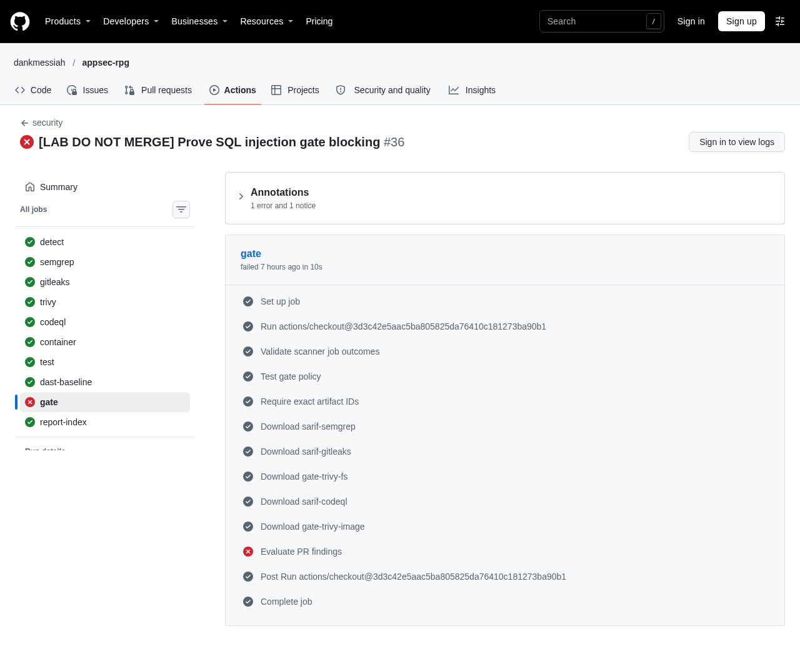

# AppSec RPG merge gating policy

The security workflow evaluates the pull request evidence. Required-check enforcement depends on the main ruleset configuration described below.

## What blocks

The gate focuses on findings introduced by the PR. Preexisting findings are tracked through the existing triage process.

| Source | Blocking condition |
|---|---|
| Gitleaks | Any secret reported in commits reachable from the PR head but outside the merge-base history. |
| Semgrep custom SQL rule | A new finding from the exact emitted ID `semgrep.rules.db-query-string-concat`. |
| Semgrep registry rules | A new finding from an exact allowlisted Sequelize injection, code string concatenation, or Express open redirect ID at effective `ERROR` severity. The current open redirect descriptor is `warning` and stays ticket-only at that severity. |
| CodeQL | Any new High or Critical alert. GitHub code scanning evaluates newness in the repository ruleset. |
| Trivy filesystem and image | A new Critical CVE with a fixed version available and either a CISA KEV listing or a FIRST EPSS score of at least 0.1. |
| `test` | Failure of the separate `npm test` check. |

The precise Semgrep IDs and thresholds are in `.github/gate-rules.txt`. Effective severity comes from the result's level when present, then the rule descriptor's default. The Juice Shop calibration excluded non-executed challenge snippets when measuring runtime precision.

## Ticket-only findings

- Semgrep rules outside the allowlist, including the custom `battle-route-missing-owner-check` heuristic, `express-res-sendfile`, `express-check-directory-listing`, and `run-shell-injection`.
- Trivy configuration findings, CycloneDX inventory, ZAP baseline and nightly DAST.
- Findings already present in the applicable baseline.

## Evidence and baseline

- Semgrep checks the exact PR head with `--baseline-commit` set to the merge base. Gitleaks scans `merge-base..head`. The `sarif-semgrep` and `sarif-gitleaks` artifacts contain the scoped PR results. Push and manual runs scan the full tree and history for triage.
- CodeQL publishes `sarif-codeql` and uploads to the Security tab when code scanning is enabled. The gate checks that analysis produced valid evidence. GitHub independently evaluates alert severity and newness.
- Trivy retains `sarif-trivy` and `sarif-trivy-image` for reporting. For the gate, `gate-trivy-fs` and `gate-trivy-image` hold the head and merge-base native JSON reports. Each comparison uses one scanner and vulnerability database snapshot. The image pair pins shared external base references to the same digest for both builds. A merge base with no Dockerfile is an explicit empty image baseline.
- Trivy matches the CVE, ecosystem, logical target or package path, and package identity across revisions. Installed version, image tags, and line numbers are excluded from the matching key. A finding in a second target or package copy can therefore be new.
- The gate requests KEV and EPSS data only for eligible new Critical candidates. KEV membership alone is sufficient. Missing scores and source failures leave a candidate unresolved unless the other source independently establishes exploitability.
- The PR-only `gate` runs after the required scanner jobs. A failed scanner, unexpected skip, missing or invalid report, or unresolved candidate fails the gate as incomplete evidence. An empty valid report is allowed. Gate summaries contain rule or CVE identifiers and Trivy package details, with raw secret messages kept out.

## Ruleset and proof

1. Require `gate` and `test` in the main ruleset.
2. Require GitHub code scanning results from CodeQL at High or higher severity.
3. Verify a clean PR passes. Verify an unmerged `demo/gate-sqli` PR with a deliberately concatenated `db.query` fails the gate and capture sanitized evidence.

## Recorded blocking proof

[Deliberate SQL injection PR #18](https://github.com/dankmessiah/appsec-rpg/pull/18) was closed without merging. The captured run shows the `gate` job failing specifically at `Evaluate PR findings`, while the scanner jobs completed successfully. This distinguishes a policy rejection from a scanner execution failure. The screenshot records the job result, not the historical merge-button state or detailed logs.

## Exceptions and review

- A false positive requires AppSec review through CODEOWNERS. Use a justified inline `nosemgrep` annotation with a ticket or a reviewed `.gitleaks.toml` allowlist entry.
- An accepted risk requires an AppSec-approved Jira exception with an expiry. Repository admin bypasses are logged and reviewed in weekly triage.
- Re-measure Semgrep precision monthly. Review a rule for ticket-only treatment if precision falls below 90% over at least 20 findings.
